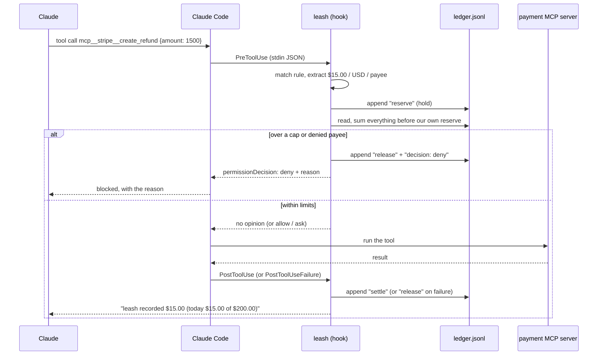

# cc-leash

**Spending limits for Claude Code.** A plugin that checks every MCP tool call that moves money (Stripe, PayPal, x402, Coinbase AgentKit and other wallets, `capline-mcp`, or anything that looks like a payment) against per-call, per-session and daily caps and a payee list, before the call runs.

[](https://github.com/agnij-dutta/cc-leash/actions/workflows/ci.yml) · MIT · zero runtime dependencies · Node.js 18+

```
$ bash examples/demo/demo.sh -p 'Pay acme-supplies $500 for Q4 server credits, then pay them $20 for a domain renewal. Report what happened.' < /dev/null

One of the two payments went through and the other was blocked.

1. **$500 to acme-supplies for Q4 server credits: blocked, nothing sent.** The leash spending guard
   stopped it because it's over the $100 limit for a single payment. I didn't retry, and I didn't
   split it into smaller payments to get under the limit.
2. **$20 to acme-supplies for the domain renewal: paid.** Payment ID is `pay_0001`, and the account
   balance is now $9,980.00.
...

$ node scripts/leash.mjs status        # the same view as /leash:status
...
Recent
  18:25:56  DENY           $500.00  -> acme-supplies            fakepay.pay  over the per-call cap of $100.00
  18:26:03  ALLOW           $20.00  -> acme-supplies            fakepay.pay
  18:26:03  PAID            $20.00  -> acme-supplies            fakepay.pay
```

<sub>Captured 2026-10-04 with Claude Code 2.1.289 on macOS against the bundled `fakepay` demo server (no real money). Claude's wording changes from run to run; the hook's decision and the ledger rows don't. Output trimmed where marked `...`.</sub>

The limit is not a sentence in the prompt. It is a hook that runs outside the model, so the model can't talk its way past it.

## Why

Give Claude Code a payment MCP server and it can spend whatever that server's API key allows. A prompt injection in a fetched page, or a misread instruction ("pay them 500" when you meant 5.00), is one tool call away from real money. Claude Code's permission prompt asks whether `fakepay.pay` may run. It has no idea of amounts, payees or what was already spent today, and once you click "always allow" it stops asking at all. cc-leash adds that missing budget layer, and an audit log of every attempt.

## Quickstart

Requires Node.js 18+ and [Claude Code](https://code.claude.com/docs) (logged in). No payment credentials needed: the repo ships a fake payment MCP server.

```bash
git clone https://github.com/agnij-dutta/cc-leash && cd cc-leash
npm test                    # 49 tests, no install needed
bash examples/demo/demo.sh  # interactive Claude Code session with leash + fakepay
```

`demo.sh` starts Claude Code in a throwaway directory with this repo loaded through `--plugin-dir` (nothing is installed), the `fakepay` server, a demo policy ($100 per call, $250 per session, $500 per day, ask above $75) and a throwaway ledger. Your own `~/.claude` settings and ledger are not touched. Then ask:

> Pay acme-supplies $500 for Q4 server credits, then pay them $20 for a domain renewal.

The $500 is denied by the hook with a reason, and the $20 goes through. Run `/leash:status` to see the meter.

Non-interactive version (what produced the output above):

```bash
bash examples/demo/demo.sh -p 'Pay acme-supplies $500 for Q4 server credits, then pay them $20 for a domain renewal. Report what happened.' < /dev/null
```

If you ask for the $20 first, Claude often declines the $500 without trying it, because the PostToolUse note already told it how much budget is left. That is leash working as designed, but the deny row then never appears in the ledger.

## Install

From GitHub:

```bash
claude plugin marketplace add agnij-dutta/cc-leash
claude plugin install leash@cc-leash
```

Or inside a session: `/plugin marketplace add agnij-dutta/cc-leash`, then `/plugin install leash@cc-leash`.

From a local clone: `claude plugin marketplace add ./cc-leash`, then `claude plugin install leash@cc-leash`. For a single session without installing anything: `claude --plugin-dir ./cc-leash`.

With no policy file, the built-in defaults apply: USD $50 per call, $100 per session, $200 per day, ask above $20, and ask whenever the amount or currency can't be read.

## Usage

### Slash commands

| Command             | What it does                                                                     |
| ------------------- | -------------------------------------------------------------------------------- |
| `/leash:status`     | Spend today against each cap, pending holds, recent allow / deny / ask decisions |
| `/leash:ledger [N]` | The last N ledger rows (default 25)                                              |
| `/leash:set [what]` | Guided policy edit, e.g. `/leash:set daily USD cap to 500`                       |

### CLI

The same things work from a terminal with `node scripts/leash.mjs <command>` (or `cc-leash <command>` after `npm link`):

| Command                                 | What it does                                                                                          |
| --------------------------------------- | ----------------------------------------------------------------------------------------------------- |
| `status [--json]`                       | Spend today vs caps, policy sources, recent decisions                                                 |
| `ledger [N] [--json]`                   | Last N decision and payment rows. `--json` (or `--raw`) prints raw events                             |
| `policy [--json]`                       | The effective merged policy, its source files, any notes, and the rule order                          |
| `set <key> <value> [--project]`         | Set a dotted key, e.g. `set limits.USD.daily 500`. `null` removes a cap, `unset` restores the default |
| `add <key> <value> [--project]`         | Append to a list, e.g. `add payees.deny "*@scam.example"`                                             |
| `remove <key> <value> [--project]`      | Remove from a list                                                                                    |
| `check <tool_name> '<tool_input json>'` | Show which rule matches and what leash extracts. Writes nothing                                       |
| `pre` / `post` / `post-failure`         | Hook entry points (hook JSON on stdin). Used by `hooks/hooks.json`                                    |

`set`, `add` and `remove` write the global policy unless `--project` is given, and refuse to save a value leash would reject.

```bash
$ node scripts/leash.mjs check mcp__stripe__create_refund '{"amount": 1999, "payment_intent": "pi_1"}'
{
  "tool": "mcp__stripe__create_refund",
  "rule": "stripe",
  "amount": 19.99,
  "currency": "USD",
  "rawCurrency": "USD",
  "payee": "pi_1",
  "amountPath": "amount"
}
```

### Policy

Two files, merged over the built-in defaults:

1. `~/.claude/leash.json`: your global policy
2. `.leash.json` in the project root: a per-project policy, which can only tighten the global one

```json
{
  "limits": {
    "USD": { "perCall": 50, "perSession": 100, "daily": 200, "confirmAbove": 20 },
    "ETH": { "perCall": 0.05, "daily": 0.2 }
  },
  "aliases": { "USDC": "USD", "USDT": "USD" },
  "payees": { "allow": [], "deny": ["*@protonmail.com"] },
  "unknownAmount": "ask",
  "dryRun": false
}
```

| Key                         | Default                             | Meaning                                                                                                           |
| --------------------------- | ----------------------------------- | ----------------------------------------------------------------------------------------------------------------- |
| `limits.<CUR>.perCall`      | USD 50                              | Deny any single call above this                                                                                   |
| `limits.<CUR>.perSession`   | USD 100                             | Deny once one Claude Code session would go over this                                                              |
| `limits.<CUR>.daily`        | USD 200                             | Deny once all sessions today would go over this (local midnight to midnight)                                      |
| `limits.<CUR>.confirmAbove` | USD 20                              | Ask you before any call above this                                                                                |
| `limits["*"]`               | unset                               | Caps for any currency not listed                                                                                  |
| `aliases`                   | USDC, USDT, PYUSD, DAI, USDS to USD | Count one currency against another's caps                                                                         |
| `payees.allow`              | `[]`                                | Case-insensitive globs (`*`, `?`). If non-empty, every other payee is denied                                      |
| `payees.deny`               | `[]`                                | Case-insensitive globs. Always denied, at any amount                                                              |
| `unknownAmount`             | `ask`                               | When the amount can't be read: `ask`, `deny` or `allow`                                                           |
| `unknownCurrency`           | `ask`                               | When the currency can't be read                                                                                   |
| `unlistedCurrency`          | `ask`                               | When the currency has no caps configured                                                                          |
| `dryRun`                    | `false`                             | Log what would happen, block nothing                                                                              |
| `enabled`                   | `true`                              | `false` turns leash off (global policy only)                                                                      |
| `autoApprove`               | `false`                             | `true`: in-policy calls skip the normal permission prompt. `false`: leash only blocks; you approve tools as usual |
| `reservationTtlMinutes`     | 15                                  | How long an approved call holds its amount if it never completes                                                  |
| `guardConfig`               | `true`                              | Ask before Claude edits the policy or ledger, or runs `leash set`                                                 |
| `projectCanLoosen`          | `false`                             | Let a project `.leash.json` override anything (global only)                                                       |
| `disableDefaultRules`       | `false`                             | Use only your own `rules`                                                                                         |
| `rules`                     | `[]`                                | Extra extractor rules for your own payment tools (see below)                                                      |
| `ignore`                    | `[]`                                | Tool-name regexes that are never treated as payments                                                              |

Amounts are in major units (dollars, not cents). Currency codes are case-insensitive. A policy file with a value of the wrong type, an unknown cap name (say `perday`) or an invalid regex is not half-applied: leash ignores the file and asks you about every payment until it is fixed, and `/leash:status` shows why.

**Project files can only tighten.** A `.leash.json` comes with whatever repo you cloned, and a repo is not necessarily on your side. By default a project policy can lower caps, add denied payees, add an allowlist (a payee must then pass both the global and the project allowlist), choose stricter fallbacks, turn `autoApprove` off and add rules for tools the built-ins don't cover. It can't raise a cap, remove one, turn on dry-run, disable leash or remap currencies. `/leash:status` lists anything it ignored. If you trust your projects, set `"projectCanLoosen": true` in the global file.

### Environment variables

See [`.env.example`](.env.example).

| Variable              | Default                         | Used by    | Meaning                                                    |
| --------------------- | ------------------------------- | ---------- | ---------------------------------------------------------- |
| `LEASH_HOME`          | `$CLAUDE_CONFIG_DIR/leash`      | hooks, CLI | Directory for the ledger                                   |
| `LEASH_LEDGER`        | `$LEASH_HOME/ledger.jsonl`      | hooks, CLI | Ledger file path                                           |
| `LEASH_GLOBAL_CONFIG` | `$CLAUDE_CONFIG_DIR/leash.json` | hooks, CLI | Global policy path                                         |
| `CLAUDE_CONFIG_DIR`   | `~/.claude`                     | hooks, CLI | Claude Code's config directory                             |
| `CLAUDE_PROJECT_DIR`  | set by Claude Code              | hooks      | Project root, where `.leash.json` is read from             |
| `LEASH_DEMO_DIR`      | a new temp dir                  | `demo.sh`  | Working directory for the demo session and its ledger      |
| `FAKEPAY_LOG`         | unset                           | fakepay    | If set, fakepay appends each payment to this file as JSONL |

### Which tools it watches

Rules are tried in order and the first match wins: your global `rules`, then the built-ins, then project `rules`.

| Rule      | Tools                                                                                                                             | Notes                                                                                                                           |
| --------- | --------------------------------------------------------------------------------------------------------------------------------- | ------------------------------------------------------------------------------------------------------------------------------- |
| `capline` | `mcp__*capline*__pay`                                                                                                             | Currency USDC                                                                                                                   |
| `fakepay` | the demo server                                                                                                                   |                                                                                                                                 |
| `stripe`  | `create_refund`, `create_payment_intent`, `create_payout`, `create_transfer`, `create_payment_link`, `finalize_invoice`, ...      | Amounts are in the currency's minor unit (cents; whole yen for JPY). Payment links carry a price id, not an amount, so they ask |
| `paypal`  | `create_order`, `capture_order`, `create_refund`, `create_payout`, `send_invoice`, ...                                            | Reads `purchase_units[0].amount.value` and friends                                                                              |
| `wallet`  | AgentKit, CDP and other wallet servers: `transfer`, `send`, `trade`, `swap`, `withdraw`, `bridge`                                 | Currency from `assetId` / `token`                                                                                               |
| `x402`    | `x402`, `pay_for`, `fetch_with_payment`, `make_payment`                                                                           |                                                                                                                                 |
| `generic` | any MCP tool with `pay`, `payment`, `transfer`, `payout`, `refund`, `charge`, `withdraw`, `purchase`, `checkout`, ... in its name | Read-only names (`get_`, `list_`, `*_status`, `*_balance`, ...) are excluded                                                    |

Add a rule for your own tool in the policy:

```json
{
  "rules": [
    {
      "id": "acmebank",
      "match": "^mcp__acmebank__wire$",
      "amount": ["wire.cents"],
      "scale": 100,
      "currency": ["wire.currency", "=USD"],
      "payee": ["wire.beneficiary.name"]
    }
  ]
}
```

Paths are dotted with `[n]` indexes, and the first path that has a value wins. A path starting with `=` is a literal. If no amount can be found, the call is escalated to you, not allowed. To ship a rule as a built-in for everyone, see [CONTRIBUTING.md](CONTRIBUTING.md#adding-an-extractor-rule-for-a-new-payment-mcp).

## How it works



- **PreToolUse** (matcher `mcp__.*`) decides. It finds the first rule that matches the tool name, pulls the amount, currency and payee out of the tool input, and checks the payee lists, the amount fallbacks, the per-call cap and the confirmation threshold. The strictest result wins (deny over ask over allow). A denial returns `permissionDecision: "deny"` with a reason Claude sees, including an instruction not to split the payment into smaller ones. In-policy calls return nothing, so your normal permission flow still applies (unless `autoApprove` is on).
- **PostToolUse** settles the hold in the ledger and tells Claude how much budget is left. **PostToolUseFailure**, and any MCP result with `isError: true`, releases the hold.
- **Ledger**: `~/.claude/leash/ledger.jsonl`, append-only, one JSON object per line, written with a single `O_APPEND` write per line and read without locks. A half-written trailing line is skipped.
- **No double spend across parallel sessions, without a lock.** An approved call first appends a `reserve` line, then reads the ledger and counts only what came before its own line. File order is the same for every reader, so when two sessions race for the last $60 of a $100 cap, the second one sees the first and denies itself. Under contention this can over-deny, never over-allow. The test suite fires 8 concurrent $40 payments at a $100 daily cap and checks that exactly 2 get through.
- **Fails closed.** An internal error, a corrupt or invalid policy file, or Node failing to start all escalate the payment to you. A crashing hook would otherwise count as a non-blocking error, and the payment would go through.
- **Guards itself.** Bash commands and file edits that touch `leash.json`, `.leash.json` or the ledger need your approval, so Claude can't quietly raise its own limit.

Code layout: `scripts/leash.mjs` (CLI and hook entry), `scripts/lib/engine.mjs` (decisions), `scripts/lib/policy.mjs` (load, validate, merge), `scripts/lib/rules.mjs` (tool matching and extraction), `scripts/lib/ledger.mjs` (JSONL ledger and totals).

## Security model and limitations

cc-leash governs what Claude Code does through MCP tools on your machine. It is a client-side guard rail, not a vault. Read [SECURITY.md](SECURITY.md) for the full threat model. In short:

- **Other paths to the money are not covered.** If Claude can reach a payment API another way, for example `curl` to the Stripe API with a key in your environment, or a script that imports an SDK, leash does not see it. Keep payment credentials inside the MCP server process, not in your shell environment or project files.
- **It trusts the tool input.** leash reads the arguments of the call. If a tool charges something other than what its arguments say (a Stripe payment link charges whatever its price says; a refund without a `currency` is assumed to be USD), leash records and limits the arguments, not the charge.
- **Coverage depends on rules.** A payment tool whose name matches no rule (`mcp__bank__do_thing`) is not checked. Use `leash check` on your servers' tool names and add rules where needed.
- **The tamper guard is a speed bump.** It catches the obvious ways to edit the policy from Bash or the edit tools. A determined command can get around a regex, and it does not stop Claude from disabling the plugin in Claude Code's own settings. Approve permission prompts with care.
- **Anyone with access to your machine** can edit the policy or the ledger.
- **A hook that times out** (15 s) renders no decision: Claude Code falls back to its normal permission flow, so a payment tool you set to "always allow" would run unchecked. The ledger is re-read on every payment call, so a very large ledger slows the hook down; see the roadmap.
- **Daily caps use local time.** Changing the system clock or time zone moves the day boundary.

For limits that hold even when the client is compromised, enforce them where the money is. [Capline](https://github.com/agnij-dutta/capline) puts the spending mandate on chain; cc-leash is the guard rail in front of it.

## Prior art

- [Claude Code hooks](https://code.claude.com/docs/en/hooks) and permission rules: the mechanism cc-leash is built on. Permission rules decide whether a tool may run at all; they have no notion of amounts or running totals.
- [Coinbase Spend Permissions](https://github.com/coinbase/spend-permissions): on-chain allowances for smart wallets, enforced by a contract. Stronger guarantees, but only for that wallet and chain.
- [Stripe Issuing spending controls](https://docs.stripe.com/issuing/controls/spending-controls): per-card limits enforced by the card network. Great when the agent pays with an issued card.
- [Stripe agent toolkit](https://github.com/stripe/agent-toolkit), [Coinbase AgentKit](https://github.com/coinbase/agentkit) and [x402](https://github.com/coinbase/x402): the payment tools and protocols cc-leash puts limits in front of.
- [Capline](https://github.com/agnij-dutta/capline): on-chain spend mandates for AI agents, by the same author.

What cc-leash adds: one budget across every payment tool Claude Code can call, across parallel sessions, with payee lists, an ask threshold and an audit log, without changing the tools themselves.

## Roadmap

- Ledger rotation or a per-day index, so the hook stays fast as the ledger grows.
- A `ConfigChange` hook so that disabling the plugin or editing its hooks in Claude Code settings also needs approval.
- Currency conversion for a single cross-currency cap (today each currency has its own caps, plus aliases).
- Recorded tool-input fixtures for more real payment MCP servers, and rules for them.
- A JSON Schema for `leash.json`, for editor completion.
- Optional settlement amounts read from tool results (for tools whose input has no amount, such as Stripe payment links).

## Contributing

See [CONTRIBUTING.md](CONTRIBUTING.md). Security issues: see [SECURITY.md](SECURITY.md), please don't open a public issue.

## License

[MIT](LICENSE) © 2026 Agnij Dutta

## Author

Agnij Dutta ([@0xholmesdev](https://x.com/0xholmesdev), [github.com/agnij-dutta](https://github.com/agnij-dutta))
